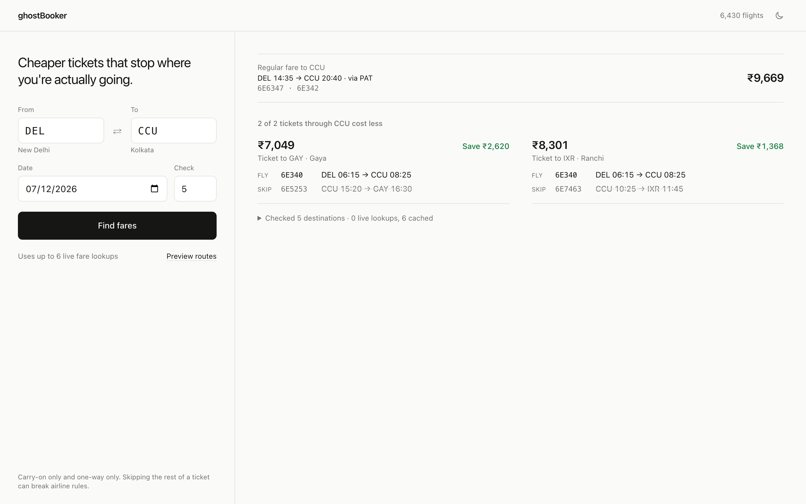
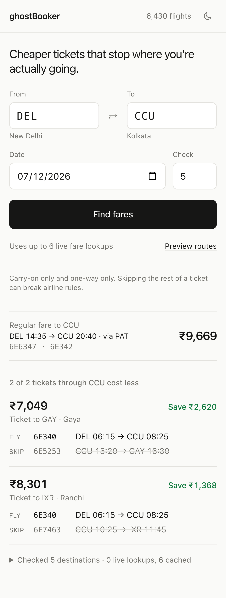

# ghostBooker

Finds cheaper "hidden-city" flight tickets in India: tickets to somewhere further away that stop at the city you
actually want to reach. You get off at your city and skip the rest.

  
  &nbsp;
  

First real result, Delhi → Kolkata on 7 Dec 2026: the regular fare was ₹9,669, while a ticket to Gaya that stops in
Kolkata cost ₹7,049 (₹2,620 less).

## How it works

1. **Schedule graph.** Every domestic flight goes into a directed graph: airports are nodes, scheduled flights are
   edges with times, weekdays and validity dates.
2. **Route search.** From your origin, it walks through your destination to every city one flight beyond it, keeping
   only connections you could actually make (same airline, 1 to 6 hour layover).
3. **Live fares, sparingly.** It ranks those cities and checks live fares for only the top few. Every fare is cached
   in Redis, so repeating a search doesn't spend another API call.
4. **Verification.** Only tickets whose itinerary really lands at your city before the last leg are shown.

## Data

- **Schedules:** a free [Indian domestic flight schedule dataset](https://huggingface.co/datasets/Kabil007/IndianDomesticAirlineDataset)
  on Hugging Face, re-dated to this year's seasons
- **Airports:** [OurAirports](https://ourairports.com/data/)
- **Live fares:** the [Ignav](https://ignav.com) API

## Run it

- `backend/`: Node.js, Express, MySQL and Redis. Setup and endpoints are in [backend/README.md](backend/README.md).
- `frontend/`: React, Vite and Tailwind. See [frontend/README.md](frontend/README.md).

## Limitations

It's an early version: the schedule data is last year's, smaller airports are patchy, and it only covers India.
Hidden-city tickets work only one-way with carry-on bags, and skipping part of a ticket can break airline rules.
